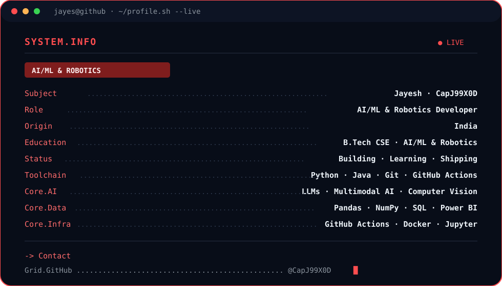
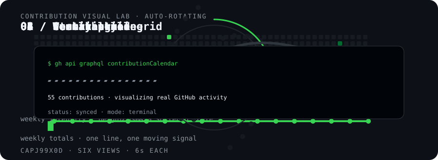

  
  

  

## About me

I build practical software around **LLMs, multimodal AI, machine learning, automation, robotics, and developer tools**. I enjoy turning rough ideas into useful prototypes and documenting the learning process.

- 🔭 Building LLM-powered and multimodal AI applications
- 🧠 Exploring vision-language models, speech AI, computer vision, and retrieval
- 🛠️ Interested in clean interfaces, useful APIs, and reproducible projects
- 🤝 Open to thoughtful collaboration and technical discussions

## Technical focus

- 🤖 **LLM & GenAI:** LLM integration, Groq, Qwen, prompt engineering, multimodal pipelines, retrieval and vector search
- 🎙️ **Speech & vision:** Whisper, SpeechRecognition, Deepgram TTS, OpenCV, Gradio
- 🧪 **Machine learning:** Scikit-learn, Pandas, NumPy, regression, classification, clustering, feature engineering, model evaluation
- 💻 **Languages:** Python, Java, R, SQL
- 📊 **Data:** EDA, Power BI, Tableau, Excel, DBMS
- 🛠️ **Tools:** Git, GitHub, Jupyter, GitHub Actions

## Featured work

| Project | What it shows |
|---|---|
| [AI-PROJECTS](https://github.com/CapJ99X0D/AI-PROJECTS) | Applied AI/ML experiments and notebooks |
| [Test-remote-mcp-server](https://github.com/CapJ99X0D/Test-remote-mcp-server) | A Python MCP server experiment |
| [newrepo](https://github.com/CapJ99X0D/newrepo) | Open-source collaboration and pull-request workflow |

## Experience & credentials

- **AI/ML Intern** — Pantech Prolabs India Pvt. Ltd. (Pantech.AI), Nov 2025–Feb 2026
- **B.Tech CSE (AI, ML & Robotics)** — DIT University, expected 2027
- Certifications: Stanford ML Specialization · Harvard CS50 AI · Oracle Generative AI · Oracle AI Vector Search · Oracle Agentic AI Foundations

## Toolkit

         

## GitHub activity

## System.Info

  

## Contribution Visual Lab

  

_Six contribution views rotate automatically every ~6 seconds: grid · skyline · weekly pulse · year ring · streak · terminal._
